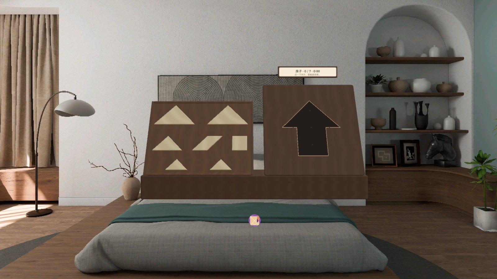
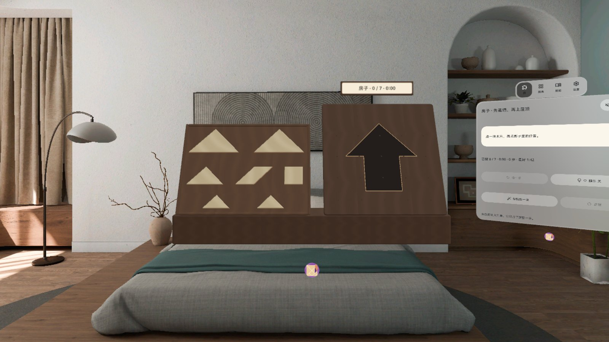
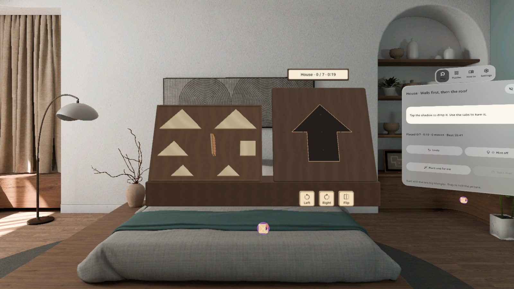
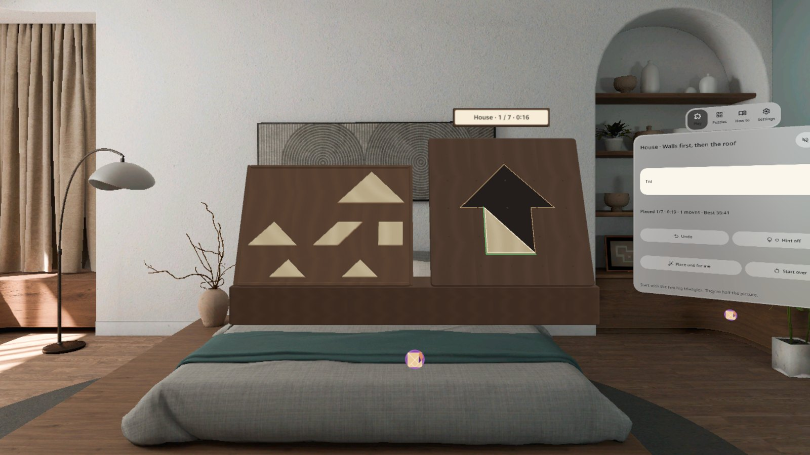
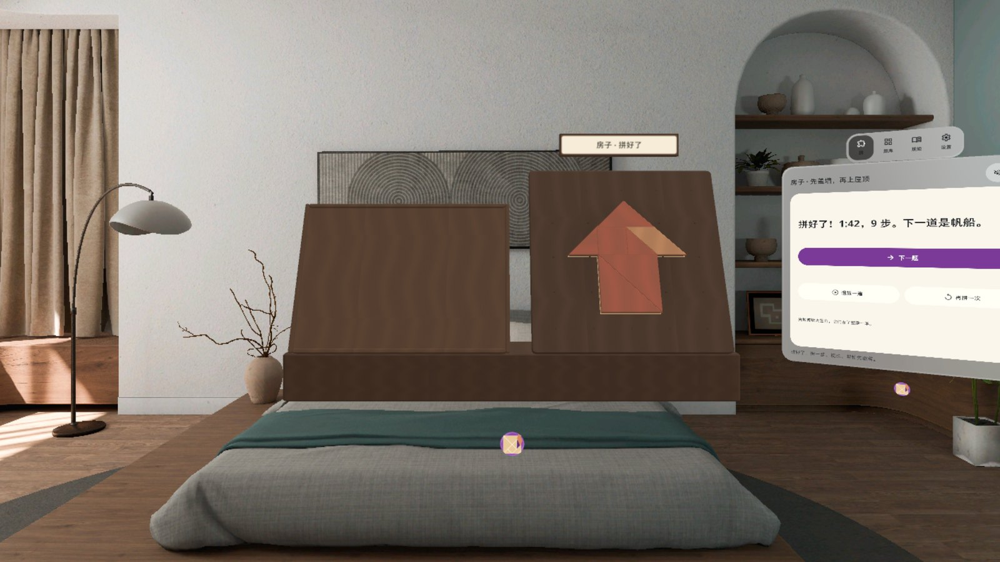
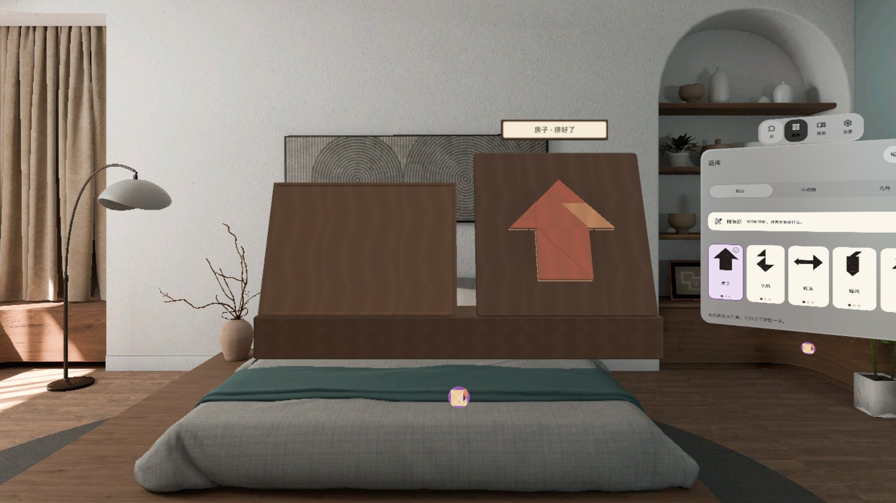
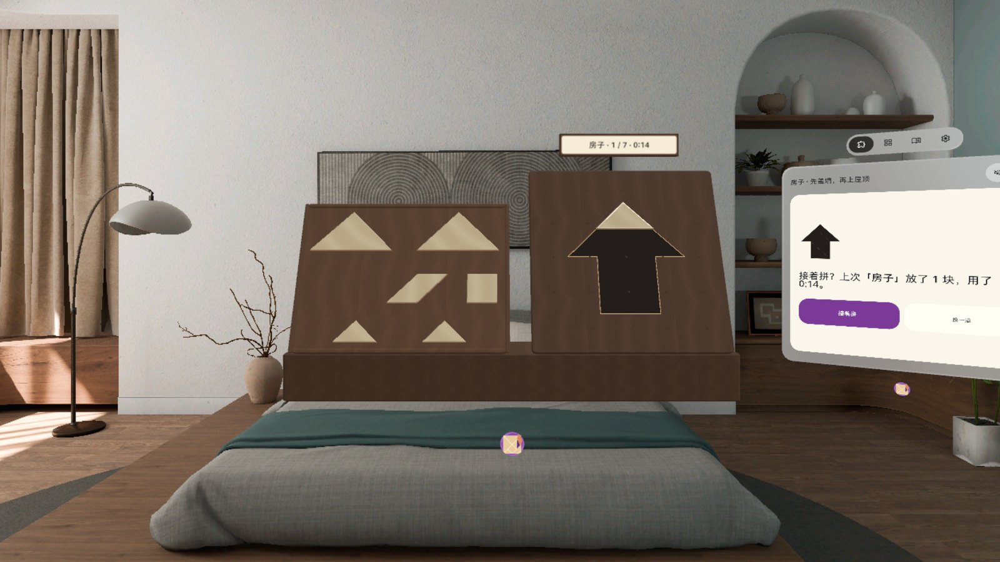
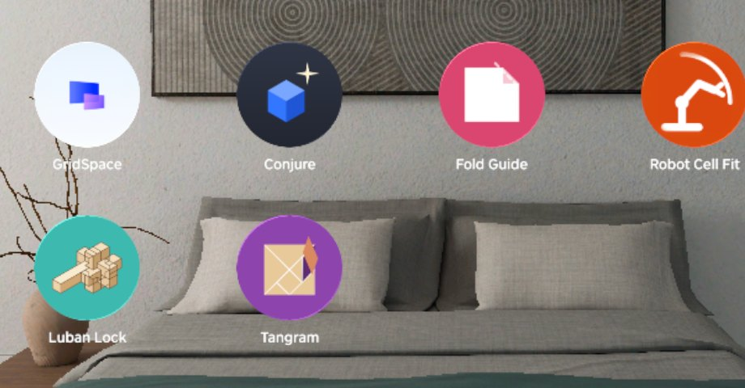

<p align="center"></p>

# Tangram | 七巧板

**桌上一副有厚度的木七巧板：点一块、点一下影子，它就飞过去；转一转、翻一翻，把七块都放进题板上的影子里。**

**A thick wooden tangram on your desk: tap a piece, tap the shadow, and it flies over; turn it, flip it, and fit all seven pieces into the shadow on the board.**

PICO OS 6 · PICO Spatial SDK 6.1.9 · Kotlin / SpatialUI · Shared Space · package `com.kejing.tangramwood` · v0.1.1 (pre-release / 预发布)

> **模拟器 QA 通过，真机未验证（Simulator QA passed; not yet verified on a real headset）。**

## 安装 / Install

从 [Releases](https://github.com/kejing-dev/Tangram/releases) 下载 `Tangram-v0.1.1.apk`，头显用 USB 连电脑后：
Download `Tangram-v0.1.1.apk` from [Releases](https://github.com/kejing-dev/Tangram/releases), connect the headset over USB, then:

```bash
adb install -r Tangram-v0.1.1.apk
```

```bash
pico-cli app launch com.kejing.tangramwood
```

没有 pico-cli 时也可以：`adb shell monkey -p com.kejing.tangramwood -c android.intent.category.LAUNCHER 1`，或在头显的应用库里点「七巧板 / Tangram」。
Without pico-cli: `adb shell monkey -p com.kejing.tangramwood -c android.intent.category.LAUNCHER 1`, or open "Tangram" from the headset's app library.

需要 PICO OS 6 头显或 PICO Emulator 6.1。APK 是 debug 包，可以直接 `adb install`。
Needs a PICO OS 6 headset or PICO Emulator 6.1. The APK is a debug build and installs directly with `adb install`.



> 截图和演示视频来自原生模拟器（PICO Emulator 6.1），由调试广播驱动跳转到各设计状态；**非真实手势录像**。
> Screenshots and the demo video were taken on the native PICO emulator, driven by debug broadcasts; **not a recording of real hand gestures.**

---

## 中文

### 这是什么

一副放在桌上的木七巧板，在 Shared Space 里和别的应用一起用。左边是胡桃木托盘，七块枫木木片（正面枫木、反面樱桃木，有 1.3 cm 厚度）摆在各自的位置；右边是胡桃木题板，上面是一道题的影子。点一块木片把它拿起来，点影子里的一个落点格，它就飞过去；方向不对就留在手上，用题板下方的木签「左转 / 右转 / 翻面」，对上了就「咔」地吸进槽里。七块都放好，整幅变成砖红色，出结果卡（用时、步数、最好成绩），还能慢放一遍。

15 道影子题（热身 / 动物 / 形状）加「随便拼」。卡住了可以「提示」或「帮我放一块」，能撤销；中途退出下次打开会问「接着拼？」。控制窗有四页：拼 / 题库 / 规矩 / 设置。中英双语，不联网。

木片、落点格、木签都按「好点中」放大过：木片最短边 8.5 cm，题板 5 × 5 个 8.2 cm 落点格、间隙 2.5 cm，木签 8 × 8 cm；托盘和题板都后仰 70° 朝向你。

### 截图

| | |
|---|---|
|  |  |
| 选中 — 木片抬起亮边，木签在题板下方一排 | 翻面 — 平行四边形翻到一半，看得到厚度和反面 |
|  |  |
| 吸进去 —「进了！」+ 槽边绿线 | 拼好了 — 整幅砖红，用时、步数、下一题 |
|  |  |
| 题库 — 热身 / 动物 / 形状 15 道 | 接着拼 — 上次的进度还在 |

启动器图标（第二行中间「Tangram」）：



### 已知问题（QA 第 2 轮，不影响使用）

- 控制窗在模拟器默认视角下右边有一部分出了画面（体积变宽到 1.30 m 后更靠右），第一次打开时 [开始拼] 只露一半；真机视场更宽，待真机确认。
- 冷启动在模拟器上波动大：点图标到看到七巧板 1.0–11.4 秒（设计要求 2 秒内，待真机复核）。
- 英文界面步数单复数：「1 moves」应为「1 move」。
- 关掉控制窗后，题名牌第二行提示「点一下木片，面板就回来」字太小，1.75 米外看不清。
- 转向只有 45° 一步，最坏要连点 3–4 下。

还没在头显上验过：手柄射线 / 手势射线 / 眼手点木片、木签、落点格；冷启动 2 秒；捏住拖动题板上木片的手感；音效响度；控制窗在真机视场里是否完整。

### 结构与构建

- **容器**：Shared Space。主体是体积窗口 `TangramVolume`（1.30 × 0.78 × 0.32 m，固定比例），旁边是平面控制窗 `TangramControl`（640 × 620 dp，`Placement.right`）。
- 七巧板规则（落点、吸槽、顶住、撤销、存档）都在纯 Kotlin 的 `domain/`，有 37 个 JVM 单元测试（含可点目标尺寸和视角）。
- 木片是程序挤出的网格 + Canvas 画的木纹，没有外部 3D 模型。音效是 CC0 木头录音。
- 详见 [AGENTS.md](AGENTS.md)（布局、调试广播、构建命令）。

---

## English

### What it is

A wooden tangram on your desk, used in Shared Space alongside other apps. On the left a walnut tray holds the seven maple pieces (maple face, cherry back, 1.3 cm thick); on the right a walnut board shows a puzzle's shadow. Tap a piece to pick it up, tap a drop pad inside the shadow and it flies over. If its orientation is wrong it stays selected: use the tabs under the board (turn left / turn right / flip) until it clicks into its groove. With all seven in place the figure turns brick red and a result card shows time, moves and your best; you can also watch a slow replay.

15 shadow puzzles (warm-up / animals / shapes) plus free play. Stuck? Use a hint or "place one for me"; moves can be undone, and an unfinished puzzle offers to continue next time. The control window has four pages: Play / Library / Rules / Settings. Chinese and English, offline.

Every tap target is sized to be easy to hit: the shortest piece edge is 8.5 cm, the board has 5 × 5 drop pads of 8.2 cm with 2.5 cm gaps, the tabs are 8 × 8 cm, and tray and board both lean back 70° to face you.

### Screenshots

See the table above: a selected piece, a flip, a piece snapping in, a solved puzzle, the library, and resuming a saved puzzle.

### Known issues (QA round 2, none blocking)

- On the emulator's default view the right part of the control window is out of frame (further right since the volume grew to 1.30 m), so the first-run Start button is half visible; a headset has a wider view, to be confirmed.
- Cold start varies a lot on the emulator: 1.0–11.4 s from tapping the icon to seeing the tangram (the design asks for 2 s; to be checked on a headset).
- English move count: "1 moves" should be "1 move".
- With the control window closed, the second line on the title plate ("Tap a piece to bring the panel back.") is too small to read from 1.75 m.
- Turning is one 45° step at a time; the worst case needs 3–4 taps.

Not yet verified on a headset: controller ray / hand ray / eye-hand taps on pieces, tabs and pads; the 2 s cold start; the feel of pinch-dragging a piece on the board; sound loudness; whether the control window fits a headset's view.

### Structure and build

- **Containers**: Shared Space. A volume `TangramVolume` (1.30 × 0.78 × 0.32 m, fixed scale) with a planar control window `TangramControl` (640 × 620 dp, `Placement.right`) beside it.
- The rules (landing, snapping, blocking, undo, save) live in a pure Kotlin `domain/` with 37 JVM unit tests (including tap-target sizes and angles).
- Pieces are procedural extrusions with Canvas-drawn wood grain; no external 3D models. Sounds are CC0 wood recordings.
- See [AGENTS.md](AGENTS.md) for layout, the debug broadcast and build commands.

---

## License / Credits

Source code © 2026. All rights reserved. Icons: Material Symbols (Apache-2.0). Font: Noto Sans (SIL OFL, `third_party/noto-sans`). Sounds: CC0 recordings (Kenney, freesound 254343).
